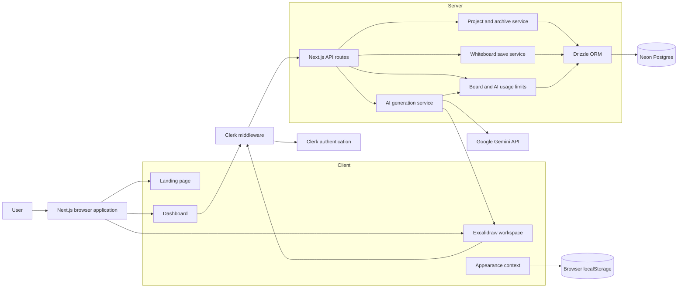

# Archflow

Archflow is a personal whiteboard for sketching ideas, mapping flows, and generating a starting diagram with Gemini. It uses Excalidraw for the canvas, Clerk for authentication, and Neon Postgres for persistence.

## Features

- Infinite Excalidraw canvas with shapes, text, freehand drawing, images, arrows, and erasing
- Custom controls for element color, stroke, opacity, order, duplication, grouping, and locking
- Sticky notes, task cards, emojis, and Lucide icons
- AI-generated diagrams, flowcharts, architecture diagrams, and wireframes
- Manual save and autosave every 20 seconds
- Board preview images on the dashboard
- PNG export
- Board search and sorting
- Archive, restore, and permanent deletion
- Three interface color schemes and three font choices
- Responsive, collapsible dashboard navigation

## Tech stack

- Next.js and React
- TypeScript
- Excalidraw
- Tailwind CSS
- Clerk
- Neon Serverless Postgres
- Drizzle ORM and Drizzle Kit
- Google Gemini API through `@google/genai`
- Base UI and shadcn-style UI components

## Requirements

- Node.js 20 or newer
- pnpm
- A Neon Postgres database
- A Clerk application
- A Gemini API key for AI generation

## Local setup

1. Install dependencies.

   ```bash
   pnpm install
   ```

2. Copy the environment template.

   ```bash
   cp .env.example .env.local
   ```

3. Add your Neon, Clerk, and Gemini credentials to `.env.local`.

4. Push the current schema to the database.

   ```bash
   pnpm db:push
   ```

5. Start the development server.

   ```bash
   pnpm dev
   ```

6. Open [http://localhost:3000](http://localhost:3000).

For this project, `db:push` is sufficient for a new database or a small development database where migration history is not required. For a production database with important data, review generated migrations before changing the schema.

## Environment variables

| Variable | Required | Purpose |
| --- | --- | --- |
| `DATABASE_URL` | Yes | Neon Postgres connection string used by the app and Drizzle Kit |
| `NEXT_PUBLIC_CLERK_PUBLISHABLE_KEY` | Yes | Public Clerk key used in the browser |
| `CLERK_SECRET_KEY` | Yes | Private Clerk key used on the server |
| `NEXT_PUBLIC_CLERK_SIGN_IN_URL` | Recommended | Clerk sign-in route; normally `/sign-in` |
| `NEXT_PUBLIC_CLERK_SIGN_UP_URL` | Recommended | Clerk sign-up route; normally `/sign-up` |
| `GEMINI_API_KEY` | For AI features | Server-side key used to generate diagrams |
| `NEXT_PUBLIC_APP_URL` | Optional | Reserved application URL; currently not read by the app |

Do not commit real credentials. Local environment files are ignored by Git.

## Commands

| Command | Description |
| --- | --- |
| `pnpm dev` | Start the local development server |
| `pnpm build` | Create a production build |
| `pnpm start` | Run the production build |
| `pnpm lint` | Run ESLint |
| `pnpm db:push` | Apply the schema directly to the configured database |
| `pnpm db:generate` | Generate Drizzle migration files from schema changes |
| `pnpm db:studio` | Open Drizzle Studio |

## Application behavior

### Boards

Each account can have up to three active boards. Archived boards do not count toward this limit. Restoring an archived board is rejected when all three active slots are already in use.

Board creation and restoration use a Postgres advisory transaction lock so simultaneous requests cannot claim the same final slot.

### Saving

Canvas changes are collected and saved after 20 seconds. The Save button writes immediately. Returning to the dashboard from the canvas also saves the current board first.

Each save stores:

- Excalidraw elements
- Persistent canvas state
- Uploaded files
- A small WebP preview for the dashboard

Interaction-only state such as the selected tool and selected elements is removed when a board is reopened.

### AI generation

The AI helper supports diagrams, flowcharts, architecture diagrams, web wireframes, and mobile wireframes.

- Primary model: `gemini-3.5-flash-lite`
- Fallback model: `gemini-3.1-flash-lite`
- Daily limit: 10 generation attempts per Clerk user
- Reset time: midnight UTC

Usage is reserved before a request to prevent concurrent requests from exceeding the daily limit. If both models are unavailable with a `503`, or Google rejects the server's response schema, the reservation is refunded and the user is told that their quota was not reduced.

AI prompts are sent to Google's Gemini API. The application does not write prompts, generated content, board data, user details, or provider responses to the console.

### Appearance

Color scheme and interface font preferences are stored in browser `localStorage`, scoped to the signed-in Clerk account. They are not stored in Postgres and do not change text already placed on a canvas.

## Project structure

```text
app/
  api/                  API routes for users, projects, whiteboards, and AI
  dashboard/            Board list, archive, and settings pages
  workspace/[projectId]/
                         Whiteboard workspace
components/
  custom/Dashboard/     Dashboard-specific components and styles
  custom/Workspace/     Canvas tools, AI panel, and workspace controls
  landing/              Public landing page
  ui/                   Reusable UI primitives
context/                User details and appearance state
db/                     Drizzle client and Postgres schema
lib/                    Limits, usage accounting, appearance, and utilities
public/                 Static assets
utils/                  Excalidraw persistence and preview helpers
```

## High-level architecture



The browser owns the interactive canvas and converts Gemini's structured response into Excalidraw elements. Next.js API routes verify the Clerk session before reading or writing board data. Drizzle handles database access, while appearance preferences remain on the user's device.

## API routes

All board and workspace routes require a Clerk session. Board queries are scoped to the signed-in user's primary email address; AI usage is keyed by the Clerk user ID.

| Route | Methods | Purpose |
| --- | --- | --- |
| `/api/users` | `POST` | Create or load the local user record and current board usage |
| `/api/projects` | `GET`, `POST`, `PATCH`, `DELETE` | List, create, load, archive, restore, or permanently delete boards |
| `/api/whiteboard` | `POST` | Insert or update saved canvas data after checking board ownership |
| `/api/ai` | `POST` | Reserve usage, call Gemini, validate the result, and return diagram elements |

## Database

The schema is defined in `db/schema.ts` and contains four tables:

- `users`: local user profile and legacy credit value
- `projects`: board identity, ownership, name, and archive state
- `whiteboardData`: one saved canvas and preview per project
- `ai_daily_usage`: per-user AI request count keyed by UTC date

Active board availability is calculated from the `projects` table. The legacy `users.credits` column is not the source of truth.

## Deployment

The app can be deployed on any platform that supports Next.js.

Before deploying:

1. Configure all required environment variables on the hosting platform.
2. Set `NEXT_PUBLIC_APP_URL` to the public application URL if it is used by your deployment setup.
3. Run `pnpm db:push` against the intended database after reviewing the schema change.
4. Run `pnpm build` locally or in CI.

Keep `DATABASE_URL`, `CLERK_SECRET_KEY`, and `GEMINI_API_KEY` server-side. Only variables prefixed with `NEXT_PUBLIC_` are safe to expose to the browser.
